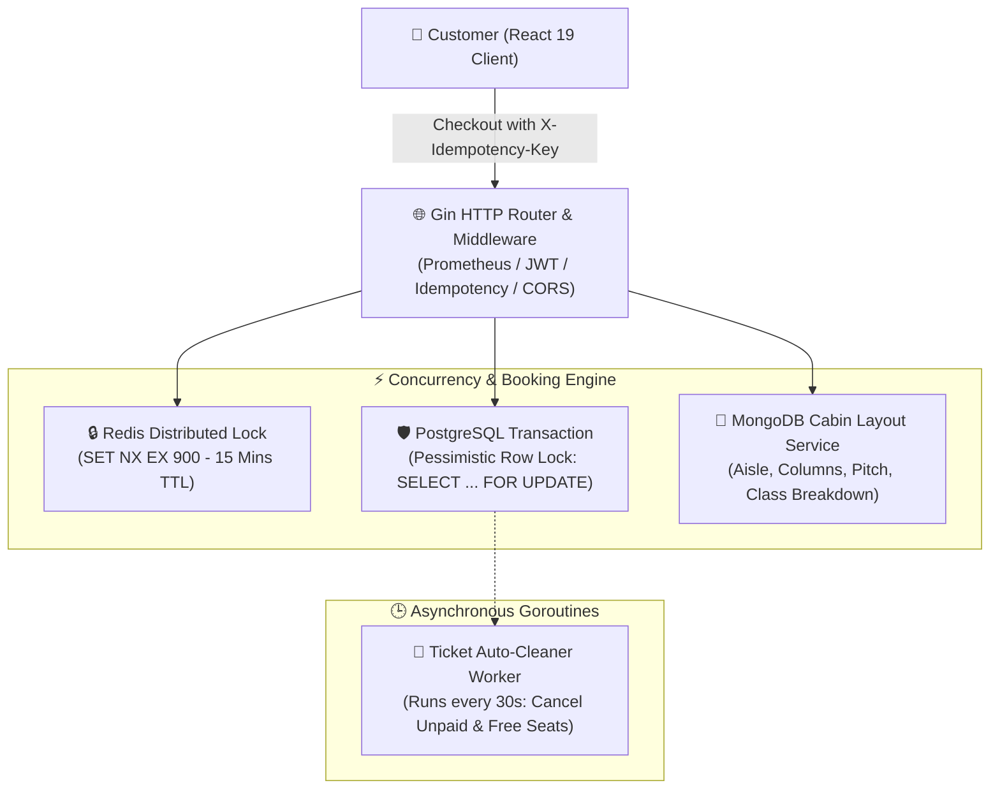

# 🛫 FlyBook - Enterprise High-Concurrency Flight Booking Platform

[](https://go.dev/)
[](https://gin-gonic.com/)
[](https://react.dev/)
[](https://www.postgresql.org/)
[](https://www.mongodb.com/)
[](https://redis.io/)
[](https://www.docker.com/)
[](https://github.com/DujanahSr/uas-react-final/actions)

> **FlyBook** adalah platform pemesanan tiket pesawat skala enterprise yang dibangun dengan backend performa tinggi **Golang (Gin)** dan frontend modern **React 19**. Dirancang khusus untuk menangani skenario dunia nyata yang kompleks: transaksi konkuren tinggi (high-concurrency), pencegahan overbooking kursi dengan **Distributed Locking (Redis)**, validasi **Idempotency Key**, serta arsitektur database **Polyglot Persistence**.

---

## 🏛️ Arsitektur Sistem & Alur Transaksi



---

## 🚀 Fitur Unggulan Tingkat Industri

### 1. 🔒 Distributed Seat Locking (15-Minute TTL)
* Mengatasi masalah *race condition* saat ribuan pengguna berebut kursi pesawat yang sama di detik yang bersamaan.
* Menggunakan Redis `SET NX EX 900` untuk reservasi kilat di level cache dan sinkronisasi row status `LOCKED` di PostgreSQL.
* Dilengkapi countdown timer real-time di UI pengguna.

### 2. 💳 Validasi Idempotensi (Idempotency Key)
* Mencegah pemotongan saldo / pembuatan tiket ganda ketika pengguna mengklik tombol "Bayar" berkali-kali karena koneksi lambat.
* Header `X-Idempotency-Key: <UUID>` divalidasi oleh Gin middleware dan dicache di Redis selama 15 menit.

### 3. 🧩 Polyglot Persistence (Multi-Database Sesuai Kebutuhan)
* **PostgreSQL 16**: Menyimpan data transaksional yang membutuhkan kepatuhan ketat **ACID** (Akun Pengguna, Jadwal Penerbangan, Pemesanan, Pembayaran, Status Kursi).
* **MongoDB 7.0**: Menyimpan denah kabin pesawat yang dinamis (*Cabin Classes*, *Exit Rows*, *Aisle Indices*, *Seat Pitch*) tanpa membebani skema relasional.
* **Redis 7.0**: Cache jadwal penerbangan, session storage, distributed lock, dan idempotency cache.

### 4. 🧹 Background Goroutine Worker (Auto-Cancellation)
* Worker asinkron berjalan di background setiap 30 detik untuk mendeteksi tiket berstatus `PENDING_PAYMENT` yang telah melewati batas 15 menit.
* Mengubah status booking menjadi `CANCELLED` dan secara otomatis mengembalikan kursi menjadi `AVAILABLE`.

### 5. 📊 Observability & Metrics
* Endpoint `/metrics` standar **Prometheus** untuk memonitor traffic latency, request rate, dan database connection pooling.
* Structured logging berkecepatan tinggi menggunakan **Uber Zap**.
* Endpoint `/api/v1/health` untuk memantau status kesehatan PostgreSQL, MongoDB, dan Redis secara instan.

---

## 📂 Struktur Monorepo Proyek

```
uas-react-abu/
├── .github/workflows/ci.yml       # GitHub Actions CI/CD (Go Vet, Test, React Build)
├── docker-compose.yml             # Orkestrator Docker (Postgres, Mongo, Redis, Golang)
├── docs/
│   ├── API_DOCUMENTATION.md       # Dokumentasi API Lengkap
│   └── openapi.yaml               # Spesifikasi Standar OpenAPI 3.0 / Swagger
├── client/                        # Frontend Application (React 19 + Tailwind CSS)
│   ├── src/
│   │   ├── api/                   # Axios Client & Interceptors (JWT + Idempotency)
│   │   ├── components/            # Komponen UI (Termasuk SeatMapModal interaktif)
│   │   ├── context/               # AuthContext & DataContext (Dual-Mode Sync)
│   │   └── pages/                 # Halaman User & Admin Dashboard
│   └── package.json
└── server/                        # Backend Application (Golang Gin Enterprise)
    ├── cmd/api/main.go            # Entrypoint API & Dependency Injection
    ├── Dockerfile                 # Multi-stage minimal production image
    ├── internal/
    │   ├── config/                # Environment & Database Connection Pooling
    │   ├── delivery/http/         # HTTP Controllers / Handlers
    │   ├── delivery/middleware/   # JWT, Idempotency, Prometheus Middleware
    │   ├── domain/                # Entity Models & DTO Interfaces
    │   ├── repository/            # Postgres GORM, Mongo Driver v2, Redis Repo
    │   ├── usecase/               # Business Logic Layer
    │   └── worker/                # Background Ticket Cleaner Goroutines
    ├── pkg/                       # Reusable Logger, JWT Token, API Response
    └── go.mod
```

---

## ⚡ Panduan Menjalankan Proyek

### Prasyarat
* [Docker Desktop](https://www.docker.com/products/docker-desktop/) sudah terinstall dan berjalan.
* [Node.js](https://nodejs.org/) v20+ & [pnpm](https://pnpm.io/)
* [Go](https://go.dev/) v1.23+ (opsional jika menjalankan Go tanpa Docker)

---

### Cara 1: Menjalankan Seluruh Sistem dengan Docker (Paling Praktis)

Cukup satu perintah di root direktori proyek:

```bash
docker compose up -d --build
```

Layanan yang otomatis aktif:
* **Backend API (Golang)**: `http://localhost:8080/api/v1`
* **PostgreSQL 16**: Port `5433` (Database: `flybook_db`)
* **MongoDB 7.0**: Port `27017` (Database: `flybook_nosql`)
* **Redis 7.0**: Port `6379`
* **Health Check**: `http://localhost:8080/api/v1/health`
* **Prometheus Metrics**: `http://localhost:8080/metrics`

Untuk menjalankan frontend:
```bash
cd client
pnpm install
pnpm run dev
```
Frontend akan aktif di `http://localhost:5173`.

---

### Cara 2: Menjalankan Backend Secara Lokal (Development Mode)

1. Jalankan container database saja:
   ```bash
   docker compose up -d postgres mongodb redis
   ```

2. Jalankan backend Go:
   ```bash
   cd server
   go run cmd/api/main.go
   ```

3. Jalankan frontend React:
   ```bash
   cd ../client
   pnpm run dev
   ```

---

## 🧪 Menjalankan Pengujian (Unit Testing)

### Backend (Golang):
```bash
cd server
go test -v -race -cover ./...
```

### Frontend (React Build Check):
```bash
cd client
pnpm run build
```

---

## 🔑 Kredensial Bawaan (Database Seeder)

Database otomatis di-seed saat server pertama kali dijalankan:

| Role | Email | Password | Hak Akses |
|---|---|---|---|
| **Super Admin** | `admin@gmail.com` | `admin123` | Akses penuh dashboard admin, analitik, dan manajemen rute |
| **Customer** | `user@example.com` | `user123` | Pencarian tiket, seat locking, pemesanan, e-ticket |

---

## 📖 Dokumentasi API

Spesifikasi lengkap REST API dapat diakses di:
* Markdown Reference: [docs/API_DOCUMENTATION.md](file:///docs/API_DOCUMENTATION.md)
* OpenAPI 3.0 / Swagger Spec: [docs/openapi.yaml](file:///docs/openapi.yaml) (Bisa diimpor langsung ke Postman, Insomnia, atau Bruno)

---

## 👨‍💻 Kontributor

* **Abu Dujanah Siregar** - *Lead Full Stack & Go Software Engineer*
* Repository: [github.com/DujanahSr/uas-react-final](https://github.com/DujanahSr/uas-react-final)
* Live Frontend: [uas-react-final.vercel.app](https://uas-react-final.vercel.app/)
